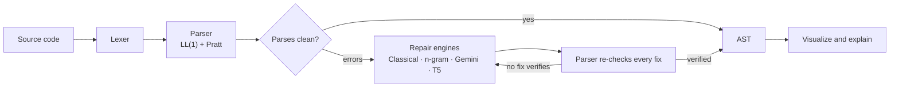
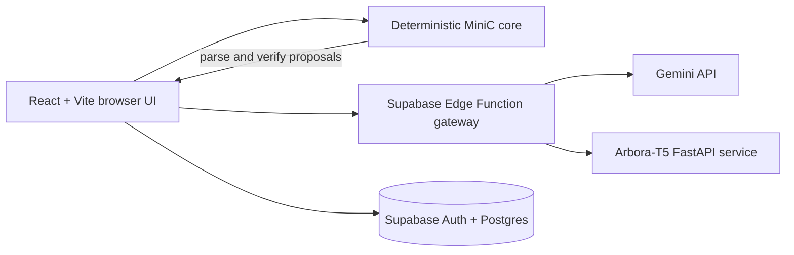

<p align="center">
  
</p>

<h1 align="center">Arbora</h1>

<p align="center"><strong>Code, grown into trees.</strong></p>

<p align="center">
  A MiniC compiler playground where models propose repairs and a deterministic parser verifies them.
</p>

<p align="center">
  <em>Compiler Design Mini Project · Guided by Dr. Rashmi Sharma</em>
</p>

<p align="center">
  <a href="https://arbora-mu.vercel.app"></a>
  <a href="https://github.com/mannbutani0306/arbora/releases/download/v1.0/CD-MP-E203_E204_E233.pptx"></a>
</p>

<p align="center">
  <a href="https://github.com/mannbutani0306/arbora/actions/workflows/ci.yml"></a>
  <a href="LICENSE"></a>
  
  
  
  
  
  
</p>

<p align="center">
  
</p>

Screenshots: [Playground](docs/media/playground.png) · [Benchmarks](docs/media/benchmarks.png). To regenerate the screenshot frames, start the app and run `npm run capture:media`; with `ffmpeg` installed it also writes `docs/media/hero.gif` and `docs/media/playground.gif`.

## Quick Links

| | |
|---|---|
| 🌐 **Live demo** | [arbora-mu.vercel.app](https://arbora-mu.vercel.app) |
| 📊 **Project presentation (PPT)** | [CD-MP-E203_E204_E233.pptx](https://github.com/mannbutani0306/arbora/releases/download/v1.0/CD-MP-E203_E204_E233.pptx) (Release v1.0) |
| 🧪 **Evaluation protocol** | [docs/EVALUATION.md](docs/EVALUATION.md) |
| 📘 **Full technical report** | [docs/REPORT.md](docs/REPORT.md) |
| 🤖 **ML reproduction instructions** | [ml/README.md](ml/README.md) |
| 📈 **Baseline results** | [results/baselines.json](results/baselines.json) |

## Table of contents

- [About](#about)
- [Why this is different](#why-this-is-different)
- [Features](#features)
- [How it works](#how-it-works)
- [Architecture](#architecture)
- [Algorithms and data structures](#algorithms-and-data-structures)
- [Measured baseline snapshot](#measured-baseline-snapshot)
- [Quick start](#quick-start)
- [Project structure](#project-structure)
- [Tech stack](#tech-stack)
- [Evaluation methodology](#evaluation-methodology)
- [Limitations](#limitations)
- [Roadmap](#roadmap)
- [Team](#team)
- [References](#references)
- [License](#license)

## About

Arbora (Latin *arbor*, "tree") is an AI-assisted compiler front-end for **MiniC**, a C-like language. Every tool that understands code, from compilers to linters, formatters and IDEs, starts by turning source text into a tree. The trouble is that parsers fail hard on broken code, and developers write broken code constantly.

Arbora keeps the guarantees of a classical parser and adds AI where it helps:

- **Guaranteed-correct AST** — a hand-written lexer and recursive-descent parser build the tree, with no parser-generator library.
- **Verified AI repair** — when code has syntax errors, models propose fixes and the same parser checks each one.
- **Explainable** — every node can be explored in an interactive visualizer and explained in plain language.

## Why this is different

Arbora separates **proposal** from **proof**. Classical search, Gemini, and optional Arbora-T5 can suggest repairs; the browser's deterministic MiniC parser checks each candidate. “Verified” means the candidate parses without errors—not that it matches the original intent or is semantically correct.

| Criterion | Classical parser | LLM only | Arbora hybrid |
|---|---|---|---|
| Correct AST on valid code | Always | Not guaranteed | Always |
| Handles broken code | Stops or cascades | Often, unchecked | Repaired and verified |
| Invalid output risk | None | High | None shown as verified |
| Explains the structure | No | Yes, may be wrong | Node-level, grounded |
| Measurable | Yes | Hard | Top-k, TED, F1 |

Parsing cleanly is not the same as matching the original code, so Arbora reports both validity and correctness.

## Features

| Area         | What you can do                                                                                    |
| ------------ | -------------------------------------------------------------------------------------------------- |
| Compiler     | Tokenize MiniC, inspect a recursive-descent/Pratt AST, explore grammar sets and conflicts          |
| Repair       | Compare classical, n-gram, Gemini, Arbora-T5, and ensemble proposals; inspect parser verification  |
| AST          | Explore, search, compare, export, and step through AST construction                                |
| Grammar Lab  | Compute FIRST, FOLLOW and the LL(1) table from a grammar                                           |
| Evaluation   | Run a small live sample or inspect committed offline benchmark results                             |
| Sharing      | Save analyses, view public shares, and inspect per-user repair history when Supabase is configured |
| Offline core | Run deterministic lexing, parsing, AST inspection, and classical repair in the browser             |

## How it works



1. **Lexical analysis** — a hand-written scanner turns source text into tokens, with line and column for each.
2. **Parse and build the AST** — recursive descent plus Pratt parsing builds a typed tree.
3. **Recover from errors** — the parser records the error, inserts an `ErrorNode` and keeps parsing, so the rest of the file still gets a tree.
4. **Repair with AI** — engines propose up to three fixes per error; only fixes that re-parse with zero errors earn the **Verified** badge. If none verifies, the engine retries with the parser's error message.
5. **Evaluate** — benchmark with top-k accuracy, tree edit distance (TED) and node F1.

**Worked example.** For the broken line `x = 2 + ;`, the parser reports an error at line 1, column 9, keeps a partial tree with an `ErrorNode` where the number should be, and the engines propose fixes such as `x = 2 + x;` (Verified) or `x = 2 + ;;` (Rejected by the parser).

## Architecture



| Layer | Responsibility |
|---|---|
| **Browser** | React and Monaco editor; a Web Worker runs the lexer and parser; interactive AST views |
| **Secure gateway** | Supabase Edge Function with auth and rate limits; API keys stay server-side |
| **AI engines** | Gemini (LLM), Arbora-T5 (CodeT5-small), classical and n-gram baselines |
| **Data** | Postgres and Auth with Row Level Security; saved analyses and benchmarks |

## Algorithms and data structures

| Algorithm | How it works |
|---|---|
| **Lexical analysis** | Scans left to right with a longest-match rule, so `>=` is one token, not `>` and `=`. Never throws: unknown characters become `ERROR` tokens. Runs in linear time, O(n), and ends the stream with `EOF`. |
| **Recursive descent + Pratt** | One function per grammar rule; Pratt parsing handles operator precedence in a single loop using binding power. `ErrorNode` markers keep the tree usable on bad input. |
| **FIRST, FOLLOW, LL(1) table** | FIRST(A) is the set of terminals that can start a string derived from A; FOLLOW(A) is the set that can appear right after A. Table cell M[A, a] holds production A → α when a is in FIRST(α), or a is in FOLLOW(A) and α can vanish. Two entries in one cell means the grammar is not LL(1). |
| **Error recovery and repair** | Record the error, insert an `ErrorNode`, resume at a safe point, then propose up to three verified fixes per error. |

| Data structure | Where Arbora uses it | Why it fits |
|---|---|---|
| Array / list | Token stream from the lexer | Indexed access gives cheap lookahead |
| Tree | AST and parse tree | Mirrors the nested structure of a program |
| Hash map | Keyword table, precedence table, LL(1) table | Constant-time lookup |
| Hash set | FIRST and FOLLOW sets | No duplicates, fast union and membership |
| Stack | Recursive parse calls and parse trace | Follows nested grammar rules |
| Ranked list | Repair candidates (top 3) | Verified fixes sorted first |

## Measured baseline snapshot

<!-- BEGIN GENERATED RESULTS -->
Quick report: **repair**, dataset “Phase 3 TypeScript parser holdout”; 30 corrupted test cases from 26 source programs. Values are estimates with 95% bootstrap intervals in parentheses.

| Model | Top-1 exact | Top-3 exact | Top-1 AST match | Top-3 AST match | Verified test-case rate |
|---|---:|---:|---:|---:|---:|
| B0 | 0.0% (0.0%–0.0%) | 0.0% (0.0%–0.0%) | 0.0% (0.0%–0.0%) | 0.0% (0.0%–0.0%) | 0.0% (0.0%–0.0%) |
| B1 | 16.7% (3.3%–30.0%) | 26.7% (10.0%–43.3%) | 16.7% (3.3%–30.0%) | 26.7% (10.0%–43.3%) | 90.0% (80.0%–100.0%) |
| B2 | 20.0% (6.7%–36.7%) | 26.7% (10.0%–43.3%) | 20.0% (6.7%–36.7%) | 26.7% (10.0%–43.3%) | 90.0% (80.0%–100.0%) |

Larger local baseline: seed 42, 811 train programs, 101 test programs, 505 generated corruption cases. This artifact does not contain confidence intervals; do not interpret this table as the quick report above.

| Model | Top-1 exact | Top-3 exact | Top-1 AST match | Top-3 AST match | Verified candidates |
|---|---:|---:|---:|---:|---:|
| B0 | 0.0% (0/505) | 0.0% (0/505) | 0.0% (0/505) | 0.0% (0/505) | 0/0 |
| B1 | 30.5% (154/505) | 42.4% (214/505) | 30.7% (155/505) | 42.4% (214/505) | 1117/1117 |
| B2 | 37.0% (187/505) | 42.4% (214/505) | 37.0% (187/505) | 42.4% (214/505) | 1117/1117 |

All figures above are read from `ml/results/evaluation_baselines.json` and `results/baselines.json`. No neural model result is inferred from a baseline.
<!-- END GENERATED RESULTS -->

The larger baseline artifact is [results/baselines.json](results/baselines.json). Its protocol and denominator are described in [docs/EVALUATION.md](docs/EVALUATION.md). Neural checkpoints have not been trained and evaluated in this repository state; no learned-model score is claimed.

## Quick start

Requires Node.js 22 and npm.

```sh
npm ci
npm run dev
npm test
npm run build
```

The app runs without Supabase configuration for local compiler features. Auth, persistence, shared analyses, and gateway-backed engines require the corresponding public Supabase URL/anon key and deployed server-side services. Copy `.env.example` to `.env.local` if configuring Supabase. Never put Gemini, Hugging Face, or Supabase service-role credentials in a `VITE_` variable.

## Project structure

| Path                            | Responsibility                                                        |
| ------------------------------- | --------------------------------------------------------------------- |
| `src/core/`                     | Deterministic lexer, parser, AST utilities, repairs, grammar, metrics |
| `src/ai/`                       | Validated AI gateway clients and engine adapters                      |
| `src/components/`, `src/pages/` | Reusable UI and routes                                                |
| `src/lib/`                      | Supabase, evaluation and shared application services                  |
| `supabase/functions/`           | Authenticated/rate-limited AI gateway                                 |
| `supabase/migrations/`          | Database schema and row-level security                                |
| `ml/`                           | Reproducible ML experiments and optional FastAPI model service        |
| `tools/`, `scripts/`            | Dataset, evaluation, validation, build and media tools                |
| `docs/`                         | Architecture, decisions, evaluation and project reports               |

## Tech stack

| Layer | Technology |
|---|---|
| Compiler core | Hand-written lexer, Pratt + recursive-descent parser, Web Worker, Zod validation |
| Frontend | React, TypeScript, Vite, Tailwind CSS, Monaco |
| AI and ML | Gemini API, CodeT5-small (Arbora-T5), PyTorch, Hugging Face Transformers, n-gram baseline |
| Backend | Supabase Postgres, Auth, Row Level Security, Deno Edge Functions, Hugging Face Space (model) |
| Quality | Vitest, fast-check, Playwright, GitHub Actions (135+ test cases per the project deck) |
| Deployment | Vercel and Docker |

## Evaluation methodology

Baselines use seeded generated MiniC programs, program-ID-isolated splits, parser-confirmed single-error corruptions, and the TypeScript parser as the validity/AST oracle. Exact match is separately checked against retained ground truth. See [evaluation protocol](docs/EVALUATION.md), [full report](docs/REPORT.md), and [ML reproduction instructions](ml/README.md).

**Reproduce the local baseline in five commands:**

```sh
npm ci
npm run bench:baselines
npm run readme:results
npm run test:coverage
npm run build
```

## Limitations

- MiniC syntax repair is not full C support and does not establish semantic correctness.
- Synthetic programs and injected single errors may not represent real developer mistakes.
- The checked-in baseline runs are small; confidence intervals from the 30-case quick report are correspondingly wide.
- Gemini and Arbora-T5 results are not included unless a dated, reproducible result artifact exists.
- Live model availability, latency, and deployment status depend on external services.

## Roadmap

- Train, evaluate, and publish repair and AST checkpoints, with complete reports and test-set provenance.
- Add independently authored held-out programs and multi-error cases.
- Extend sign-in so users can save and revisit their history.
- Add more Theory of Computation concepts to the Grammar Lab.
- Record a short product walkthrough at `docs/media/hero.gif`.

## Team

Compiler Design mini project, guided by **Dr. Rashmi Sharma**.

| Name | Roll No. |
|---|---|
| Rudrapratap Singh | E203 |
| Aaditya Agrawal | E204 |
| Mannkumar Butani | E233 |

## References

1. A. V. Aho, M. S. Lam, R. Sethi, J. D. Ullman, *Compilers: Principles, Techniques, and Tools*, 2nd ed., Pearson, 2006.
2. V. R. Pratt, "Top Down Operator Precedence," Proc. 1st ACM POPL, 1973.
3. K. Zhang and D. Shasha, "Simple Fast Algorithms for the Editing Distance Between Trees and Related Problems," *SIAM J. Computing*, 18(6), 1989.
4. Y. Wang, W. Wang, S. Joty, S. C. H. Hoi, "CodeT5: Identifier-aware Unified Pre-trained Encoder-Decoder Models for Code Understanding and Generation," EMNLP, 2021. [arXiv:2109.00859](https://arxiv.org/abs/2109.00859)
5. R. Gupta, S. Pal, A. Kanade, S. Shevade, "DeepFix: Fixing Common C Language Errors by Deep Learning," AAAI, 2017.
6. U. Alon, M. Zilberstein, O. Levy, E. Yahav, "code2vec: Learning Distributed Representations of Code," POPL, 2019. [arXiv:1803.09473](https://arxiv.org/abs/1803.09473)
7. A. Vaswani et al., "Attention Is All You Need," NeurIPS, 2017. [arXiv:1706.03762](https://arxiv.org/abs/1706.03762)
8. T. Wolf et al., "Transformers: State-of-the-Art Natural Language Processing," EMNLP (System Demonstrations), 2020. [arXiv:1910.03771](https://arxiv.org/abs/1910.03771)
9. [Tree-sitter documentation](https://tree-sitter.github.io)
10. [Supabase documentation](https://supabase.com/docs): Auth, Row Level Security, Edge Functions
11. [Google Gemini API documentation](https://ai.google.dev/gemini-api/docs)

## License

Released under the [MIT License](LICENSE) © 2026 mannbutani0306.

---

<p align="center">
  <strong>AI proposes. The parser verifies.</strong><br>
  <em>Arbora: code, grown into trees.</em>
</p>
