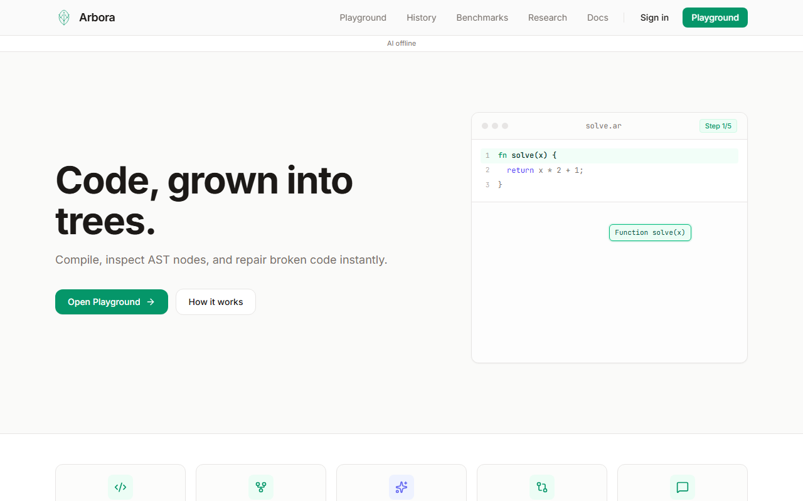
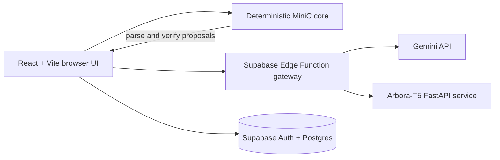

<p align="center">
  
</p>

<h1 align="center">Arbora</h1>

<p align="center"><strong>A MiniC compiler playground where models propose repairs and a deterministic parser verifies them.</strong></p>

<p align="center">
  <a href="https://github.com/mannbutani0306/arbora/actions/workflows/ci.yml"></a>
  <a href="LICENSE"></a>
  <a href="https://arbora.vercel.app"></a>
</p>

> **Demo status:** TODO — confirm that `https://arbora.vercel.app` is live and current before sharing this badge.

<p align="center">
  
</p>

Screenshot/GIF captures: [Playground](docs/media/playground.png), [Benchmarks](docs/media/benchmarks.png). To regenerate screenshot frames, start the app and run `npm run capture:media`; with `ffmpeg` installed it also writes `docs/media/hero.gif` and `docs/media/playground.gif`.

Animated hero placeholder target: `docs/media/hero.gif` (the committed `docs/media/hero.png` is the current screenshot fallback).

## Why this is different

Arbora separates **proposal** from **proof**. Classical search, Gemini, and optional Arbora-T5 can suggest repairs; the browser's deterministic MiniC parser checks each candidate. “Verified” means the candidate parses without errors—not that it matches the original intent or is semantically correct.

## Features

| Area         | What you can do                                                                                    |
| ------------ | -------------------------------------------------------------------------------------------------- |
| Compiler     | Tokenize MiniC, inspect a recursive-descent/Pratt AST, explore grammar sets and conflicts          |
| Repair       | Compare classical, n-gram, Gemini, Arbora-T5, and ensemble proposals; inspect parser verification  |
| AST          | Explore, search, compare, export, and step through AST construction                                |
| Evaluation   | Run a small live sample or inspect committed offline benchmark results                             |
| Sharing      | Save analyses, view public shares, and inspect per-user repair history when Supabase is configured |
| Offline core | Run deterministic lexing, parsing, AST inspection, and classical repair in the browser             |

## Architecture



## Measured baseline snapshot

<!-- BEGIN GENERATED RESULTS -->
Quick report: **repair**, dataset “Phase 3 TypeScript parser holdout”; 30 corrupted test cases from 26 source programs. Values are estimates with 95% bootstrap intervals in parentheses.

| Model | Top-1 exact | Top-3 exact | Top-1 AST match | Top-3 AST match | Verified test-case rate |
|---|---:|---:|---:|---:|---:|
| B0 | 0.0% (0.0%–0.0%) | 0.0% (0.0%–0.0%) | 0.0% (0.0%–0.0%) | 0.0% (0.0%–0.0%) | 0.0% (0.0%–0.0%) |
| B1 | 16.7% (3.3%–30.0%) | 26.7% (10.0%–43.3%) | 16.7% (3.3%–30.0%) | 26.7% (10.0%–43.3%) | 90.0% (80.0%–100.0%) |
| B2 | 20.0% (6.7%–36.7%) | 26.7% (10.0%–43.3%) | 20.0% (6.7%–36.7%) | 26.7% (10.0%–43.3%) | 90.0% (80.0%–100.0%) |

Larger local baseline: seed 42, 811 train programs, 101 test programs, 505 generated corruption cases. This artifact does not contain confidence intervals; do not interpret this table as the quick report above.

| Model | Top-1 exact | Top-3 exact | Top-1 AST match | Top-3 AST match | Verified candidates |
|---|---:|---:|---:|---:|---:|
| B0 | 0.0% (0/505) | 0.0% (0/505) | 0.0% (0/505) | 0.0% (0/505) | 0/0 |
| B1 | 30.5% (154/505) | 42.4% (214/505) | 30.7% (155/505) | 42.4% (214/505) | 1117/1117 |
| B2 | 37.0% (187/505) | 42.4% (214/505) | 37.0% (187/505) | 42.4% (214/505) | 1117/1117 |

All figures above are read from `ml/results/evaluation_baselines.json` and `results/baselines.json`. No neural model result is inferred from a baseline.
<!-- END GENERATED RESULTS -->

The larger baseline artifact is [results/baselines.json](results/baselines.json). Its protocol and denominator are described in [docs/EVALUATION.md](docs/EVALUATION.md). Neural checkpoints have not been trained and evaluated in this repository state; no learned-model score is claimed.

## Quick start

Requires Node.js 22 and npm.

```sh
npm ci
npm run dev
npm test
npm run build
```

The app runs without Supabase configuration for local compiler features. Auth, persistence, shared analyses, and gateway-backed engines require the corresponding public Supabase URL/anon key and deployed server-side services. Copy `.env.example` to `.env.local` if configuring Supabase. Never put Gemini, Hugging Face, or Supabase service-role credentials in a `VITE_` variable.

## Project structure

| Path                            | Responsibility                                                        |
| ------------------------------- | --------------------------------------------------------------------- |
| `src/core/`                     | Deterministic lexer, parser, AST utilities, repairs, grammar, metrics |
| `src/ai/`                       | Validated AI gateway clients and engine adapters                      |
| `src/components/`, `src/pages/` | Reusable UI and routes                                                |
| `src/lib/`                      | Supabase, evaluation and shared application services                  |
| `supabase/functions/`           | Authenticated/rate-limited AI gateway                                 |
| `supabase/migrations/`          | Database schema and row-level security                                |
| `ml/`                           | Reproducible ML experiments and optional FastAPI model service        |
| `tools/`, `scripts/`            | Dataset, evaluation, validation, build and media tools                |
| `docs/`                         | Architecture, decisions, evaluation and project reports               |

## Tech stack

React, TypeScript, Vite, Tailwind CSS, Monaco, Vitest, fast-check, Playwright, Zod, Supabase, Deno Edge Functions, Python, PyTorch, and Hugging Face Transformers.

## Evaluation methodology

Baselines use seeded generated MiniC programs, program-ID-isolated splits, parser-confirmed single-error corruptions, and the TypeScript parser as the validity/AST oracle. Exact match is separately checked against retained ground truth. See [evaluation protocol](docs/EVALUATION.md), [full report](docs/REPORT.md), and [ML reproduction instructions](ml/README.md).

**Reproduce the local baseline in five commands:**

```sh
npm ci
npm run bench:baselines
npm run readme:results
npm run test:coverage
npm run build
```

## Limitations

- MiniC syntax repair is not full C support and does not establish semantic correctness.
- Synthetic programs and injected single errors may not represent real developer mistakes.
- The checked-in baseline runs are small; confidence intervals from the 30-case quick report are correspondingly wide.
- Gemini and Arbora-T5 results are not included unless a dated, reproducible result artifact exists.
- Live model availability, latency, and deployment status depend on external services.

## Roadmap

- TODO: train, evaluate, and publish repair and AST checkpoints; commit complete reports with test-set provenance.
- TODO: add independently authored held-out programs and multi-error cases.
- TODO: confirm public production deployment and replace the demo-status TODO with verified status.
- TODO: record a short product walkthrough at `docs/media/hero.gif`.

## License

MIT. See [LICENSE](LICENSE).
