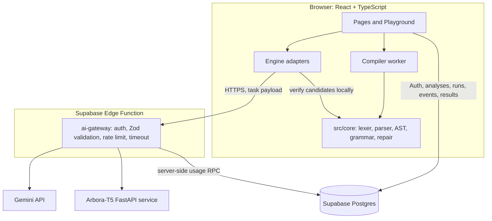
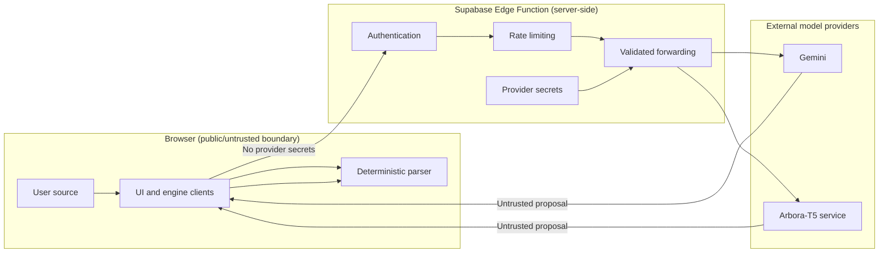

# Arbora architecture

## Component diagram

## Repair data flow

1. The editor sends source to the deterministic lexer/parser. The parser returns a `Program` AST and diagnostics; this runs locally through the compiler worker where configured.
2. A selected repair adapter submits an authenticated, schema-validated task to the Supabase `ai-gateway`. Classical and n-gram repair run locally; remote Gemini/Arbora-T5 suggestions pass through the gateway.
3. The gateway authenticates the caller, validates the task, enforces a rate limit, and forwards to a provider with a bounded timeout. Provider output is validated against response schemas before it is returned.
4. The client parses every proposed candidate with the same deterministic parser. A candidate is labeled **Verified** only when this parse has zero errors.
5. When the user has supplied ground truth (for example, via error injection), exact and AST correctness are independently compared and may be recorded in `repair_events`. These scores do not derive from parser validity.

## Neural AST data flow

1. The deterministic parser can produce the reference AST locally.
2. The selected Gemini or Arbora-T5 adapter requests an AST proposal through the gateway.
3. Response schemas and AST structure are checked on receipt. Comparisons use the local AST as the reference; a neural AST is not treated as a replacement for the deterministic parse.
4. Model-service `/health`, `/repair`, and `/ast` are exposed by the optional FastAPI service under `ml/serve/`. Its validity indicator is structural/schema validity, not proof of semantic correctness.

## Trust boundaries

The parser establishes syntax validity only. It does not prove program intent, type safety, runtime safety, or semantic equivalence. Model output remains untrusted, even when syntactically valid.

## Persistence and principal tables

| Table               | Purpose                                         | Access model                                                                       |
| ------------------- | ----------------------------------------------- | ---------------------------------------------------------------------------------- |
| `analyses`          | Saved source and analysis/share state           | Authenticated owner policies; public share retrieval through `get_public_analysis` |
| `benchmark_runs`    | Per-user live benchmark history                 | Authenticated owner policies                                                       |
| `repair_events`     | Ground-truth repair metrics for signed-in users | Authenticated owner policies                                                       |
| `samples`           | Curated sample programs                         | Public read; writes revoked from anon/authenticated                                |
| `model_evaluations` | Published offline model evaluation rows         | Public read                                                                        |
| `ai_usage`          | Gateway hourly rate-limit counters              | No anon/authenticated table access; server-side RPC path                           |

See migrations under `supabase/migrations/` for the authoritative schema and policies. See [DEPLOY.md](DEPLOY.md) for deployment and RLS-test procedures.

## Security model

- **RLS:** User-owned analyses, benchmark runs, and repair events use `auth.uid()` ownership policies. Public share access is restricted to rows that are public and retrieved through the security-definer RPC. Samples are read-only to normal application roles. `ai_usage` is not selectable by anon/authenticated roles.
- **Rate limits:** The Edge Function applies caller-level limits using the privileged `consume_ai_usage` RPC and hourly windows. Request bodies, task schemas, provider timeouts, and allowed origins are bounded.
- **Key handling:** Browser build variables are limited to the Supabase URL and public anon key (plus optional public Sentry DSN). Gemini, service-role, Hugging Face and model bearer tokens belong only in server-side secrets.
- **Model trust:** Model content is proposal data; it is not executed and is not marked syntax-verified until local parsing returns zero diagnostics.
- **Data minimization:** Structured Edge Function logs must not contain source code, prompts, authorization headers, or secret values.
- **Build checks:** The bundle secret scan checks built assets for known secret markers; it complements, but does not replace, secret management and review.
