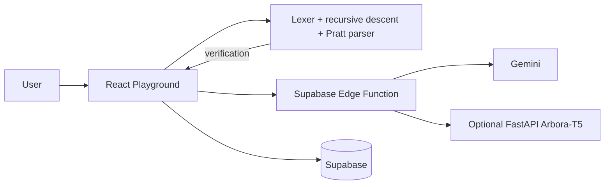
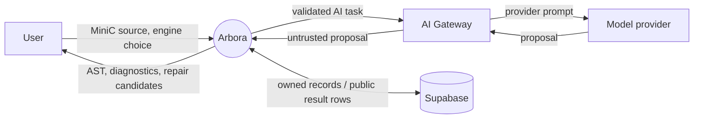
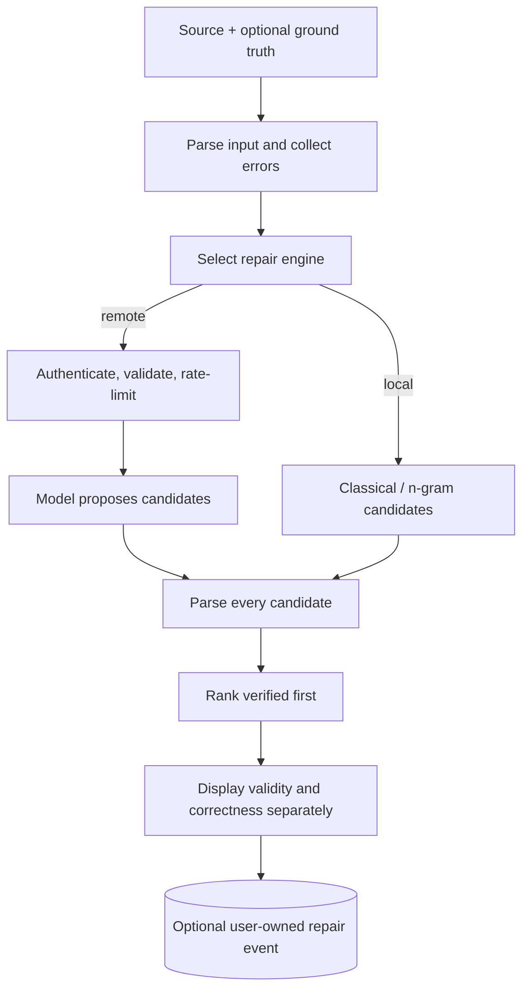
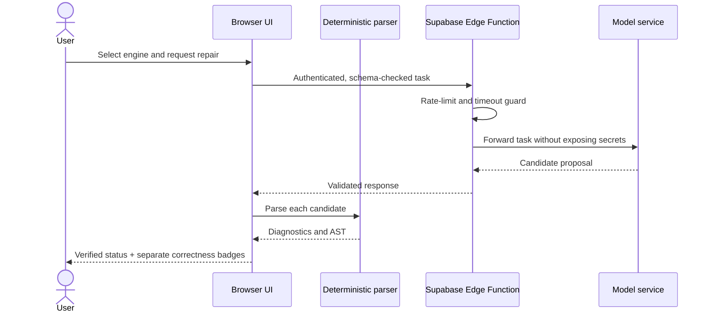
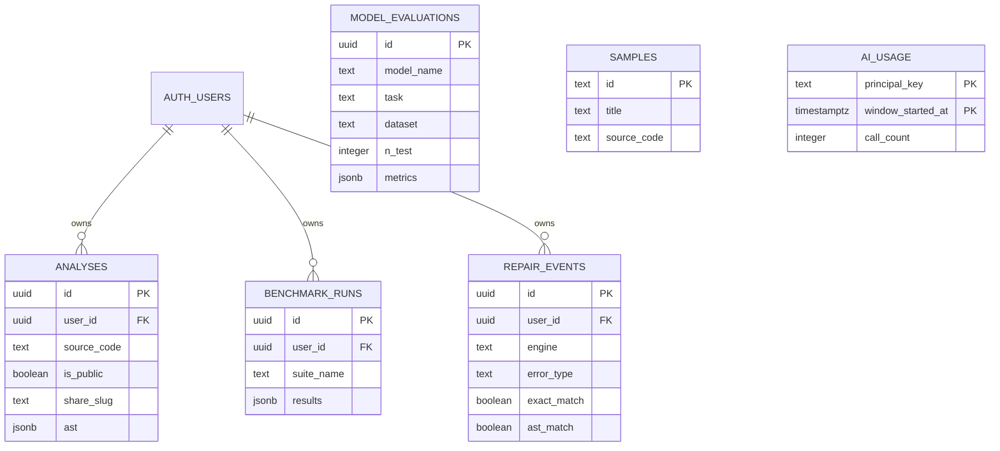

# Arbora — Compiler Design Project Report

> **Report status:** Repository-grounded draft. Values are taken from checked-in artifacts. Any item marked TODO requires confirmation or a new measurement; do not replace it with an estimate.

## Abstract

Arbora is a browser-based MiniC compiler frontend and repair playground. Its deterministic TypeScript lexer and hand-written parser construct tokens, diagnostics, and an abstract syntax tree (AST). Optional classical and model-backed engines propose repairs; the deterministic parser remains the syntax-verification authority. The repository includes grammar analysis, AST visualization, trace inspection, dataset generation, baseline evaluation, and an optional CodeT5-small serving pipeline. In the committed 505-corruption baseline artifact, classical repair and n-gram reranking provide measured top-k results; neural-model results are not reported as trained results. The key engineering claim is about the architecture and validation boundary, not that a model solves program repair.

## 1. Introduction

Compiler frontends translate source text into structured representations suitable for analysis. Arbora makes that process inspectable: users can follow source through lexical tokens, parser diagnostics, AST nodes, grammar facts, repair candidates, and comparisons. It is designed for the MiniC subset implemented in `src/core`, not for all of C.

## 2. Problem statement

Syntax errors interrupt compilation and can be difficult for learners to locate. A generative model may produce plausible repairs, but plausibility and model confidence do not prove that a candidate conforms to a grammar or preserves intended behavior. The project explores a hybrid frontend in which deterministic parsing provides structure and syntactic validation while repair engines generate candidate edits.

## 3. Objectives

- Implement a deterministic lexer/parser with useful source locations, AST output, and error recovery.
- Make grammar and AST behavior explorable in a browser.
- Offer repair proposals while retaining deterministic local verification.
- Measure syntax validity separately from ground-truth exactness and AST match.
- Provide reproducible test, dataset, and baseline workflows.
- Keep external provider secrets server-side.

## 4. Literature survey

These references are published or primary sources; verify edition/page details required by the institution before submission.

1. **DeepFix:** R. Gupta et al., “DeepFix: Fixing Common C Language Errors by Deep Learning,” _Proceedings of the AAAI Conference on Artificial Intelligence_, 2017. [AAAI proceedings search](https://ojs.aaai.org/index.php/AAAI/search/search?query=DeepFix). **TODO: verify exact authors, volume, pages, and the direct proceedings record before final citation.**
2. **code2vec:** U. Alon et al., “code2vec: Learning Distributed Representations of Code,” _Proceedings of the ACM on Programming Languages (POPL)_, 2019. [arXiv:1803.09473](https://arxiv.org/abs/1803.09473).
3. **CodeT5:** Y. Wang et al., “CodeT5: Identifier-aware Unified Pre-trained Encoder-Decoder Models for Code Understanding and Generation,” _Proceedings of EMNLP 2021: Findings_. [arXiv:2109.00859](https://arxiv.org/abs/2109.00859).
4. **Syntax-directed translation and parsing:** A. V. Aho, M. S. Lam, R. Sethi, and J. D. Ullman, _Compilers: Principles, Techniques, and Tools_, 2nd ed., Pearson, 2006. Consult the edition used and cite the relevant parsing/error-recovery chapters.
5. **Error recovery:** A. V. Aho and T. G. Peterson, “A Minimum Distance Error-Correcting Parser for Context-Free Languages,” _SIAM Journal on Computing_, 1(4), 1972. **TODO: verify the publisher record, page range, and DOI before formal submission.**
6. **Tree-sitter:** Tree-sitter is a concrete modern parser generator and incremental parsing library. [Official project and documentation](https://tree-sitter.github.io/tree-sitter/). No claim is made that Arbora uses Tree-sitter.
7. **Neural program repair:** DeepFix is directly relevant as a neural repair example. TODO: select and verify additional peer-reviewed neural program repair literature before expanding this section.

## 5. Existing systems and limitations

Traditional compiler parsers provide deterministic syntax recognition and diagnostics but generally do not propose a ranked set of likely corrections. Model-based repair systems can propose repairs but may hallucinate, over-edit, or return code that does not parse. Arbora places these approaches behind a shared verification boundary. It does not claim to outperform production compiler diagnostics or state-of-the-art repair systems.

## 6. Proposed system

The client hosts the UI and deterministic core. Local engines include no-candidate and bounded classical enumerative repair, with an n-gram ranker over classical candidates. Remote proposals pass through a Supabase Edge Function gateway to Gemini or an optional Arbora-T5 service. Every repair candidate is parsed locally before being marked Verified.

## 7. Methodology

### 7.1 Compiler frontend

- **Lexer:** `src/core/lexer.ts` scans characters into typed tokens and source positions; it is a hand-written scanner (not an automatically generated DFA). TODO: add a formal state-transition diagram and exact state inventory if required for course submission.
- **Grammar:** `src/core/grammar.ts` and `src/core/grammarAnalyzer.ts` represent productions and compute nullable, FIRST, FOLLOW, predictive-table cells, and conflicts.
- **LL(1) analysis:** The grammar is not LL(1) in its broad representation. Conflicts and parser decisions are documented in [DECISIONS.md](DECISIONS.md).
- **Parser:** `src/core/parser.ts` uses recursive descent for declarations/statements and Pratt parsing for expressions and precedence.
- **Error recovery:** The parser records diagnostics and trace steps and applies local recovery/advancement rules. TODO: enumerate recovery sets and synchronization behavior from a final code walkthrough if a formal grammar table is required.
- **AST:** Nodes have typed node kinds, child relations, and source spans; utilities support comparison, formatting, and location lookup.

### 7.2 Dataset and repair baselines

`tools/generate-dataset.ts` produces deterministic, seeded MiniC programs and removes duplicate token streams. `tools/split-dataset.ts` hashes seed plus program identity into program-level splits, preventing a program ID from crossing splits. `tools/corrupt-dataset.ts` emits parser-confirmed corruptions and preserves ground truth. The checked-in [results/baselines.json](../results/baselines.json) records seed `42`, `811` training programs, `101` test programs, and `5` corruptions per test program (`505` cases).

Baselines are:

- **B0:** no repair candidates.
- **B1:** bounded classical enumeration; only parser-verified candidates are returned.
- **B2:** trigram n-gram reranking of B1 candidates; it cannot generate new proposals.

The separate [30-case report](../ml/results/evaluation_baselines.json) contains bootstrap intervals for B0/B1/B2. It is a quick evaluation and must not be confused with the 505-case artifact.

### 7.3 Model training

The ML project configures separate `Salesforce/codet5-small` seq2seq tasks: corrupted code to original source, and source to bracketed AST. Seed, config, token-length filters, train/validation/test splits, and oracle evaluation are described in [ml/README.md](../ml/README.md). The checked-in results say neural training/evaluation has not been run in this repository state; do not report configured epochs or intended hardware as measured results.

### 7.4 Verification and metrics

- **Validity:** parser reports zero errors.
- **Exact match:** candidate tokens equal retained ground-truth tokens.
- **AST match:** parser-produced structure equals ground-truth structure under the evaluator's documented normalization.
- **Top-k:** at least one candidate among the first _k_ matches; the denominator is test cases, not candidate rows.
- **Bootstrap:** the quick report stores 95% bootstrap bounds and each metric's `n`.

See [EVALUATION.md](EVALUATION.md) for definitions and threat-to-validity details.

## 8. System design

### Block diagram

### DFD Level 0

### DFD Level 1: repair

### Sequence: remote repair

### ER diagram (application tables)

The diagram shows the principal tables represented in migrations; consult SQL for complete fields, indexes, grants, and foreign keys.

## 9. Implementation

The user interface is a React/Vite application. `src/core` contains pure deterministic compiler logic; `src/ai` contains gateway clients and engine adapters; Supabase Edge Functions handle remote AI boundary concerns; Python modules under `ml/src/arbora_ml` support data preparation and training. The FastAPI model service is optional and downloads checkpoints at startup rather than committing weights.

## 10. Testing

The latest observed local Vitest run reported **33 test files passed, 271 tests passed, 0 failed**. The separate latest coverage run executed the then-existing 270 tests but failed thresholds: overall 57.46% lines vs 75%, `src/core` 83.24% vs 90%, and `src/ai` 58.23% vs 80%. CI is configured to run typecheck, lint, coverage thresholds, Deno tests, build, bundle scan, Playwright, and Lighthouse, but it must not be described as green until coverage passes. TODO: raise coverage and paste the passing GitHub Actions run URL, date, and coverage percentages for the submitted report.

| Test layer                    | Current evidence                                                |
| ----------------------------- | --------------------------------------------------------------- |
| Unit/property/component tests | 33 files and 271 cases passed in the latest observed local run  |
| Coverage enforcement          | Vitest thresholds in `vitest.config.ts`                         |
| Deno shared-function tests    | CI command `npm run test:deno`; run-specific result TODO        |
| Browser E2E                   | Playwright Chromium workflow; run-specific result TODO          |
| Accessibility                 | axe-based checks included in UI tests; run-specific result TODO |
| Bundle secret scan            | CI checks built assets; run-specific result TODO                |
| Lighthouse                    | CI workflow runs route budgets; scores are run-specific, TODO   |

## 11. Results and analysis

All rates in this section are sourced from committed result JSON. Results do not include trained neural checkpoints.

### 505-case baseline artifact

| Model |     Top-1 exact |     Top-3 exact | Top-1 AST match | Top-3 AST match | Verified candidates |
| ----- | --------------: | --------------: | --------------: | --------------: | ------------------: |
| B0    |    0.0% (0/505) |    0.0% (0/505) |    0.0% (0/505) |    0.0% (0/505) |                 0/0 |
| B1    | 30.5% (154/505) | 42.4% (214/505) | 30.7% (155/505) | 42.4% (214/505) |           1117/1117 |
| B2    | 37.0% (187/505) | 42.4% (214/505) | 37.0% (187/505) | 42.4% (214/505) |           1117/1117 |

The 505-case artifact records 811 train programs, 101 test programs, seed 42, and five corruption attempts per test program. It contains no confidence intervals; do not infer uncertainty bounds from the point estimates.

### 30-case quick report with bootstrap intervals

| Model | Top-1 exact, 95% CI  | Top-3 exact, 95% CI  | Top-1 AST match, 95% CI | Top-3 AST match, 95% CI |
| ----- | -------------------- | -------------------- | ----------------------- | ----------------------- |
| B0    | 0.000 [0.000, 0.000] | 0.000 [0.000, 0.000] | 0.000 [0.000, 0.000]    | 0.000 [0.000, 0.000]    |
| B1    | 0.167 [0.033, 0.300] | 0.267 [0.100, 0.433] | 0.167 [0.033, 0.300]    | 0.267 [0.100, 0.433]    |
| B2    | 0.200 [0.067, 0.367] | 0.267 [0.100, 0.433] | 0.200 [0.067, 0.367]    | 0.267 [0.100, 0.433]    |

This is a 30-corruption quick evaluation from 26 source programs and should not be substituted for the 505-case artifact. B1 and B2 produce parser-verified candidates, but verified candidate rate is not exact-match accuracy. TODO: rerun with a larger held-out corpus and report its corresponding CIs before broad claims.

## 12. Limitations

- The language subset is MiniC; behavior cannot be generalized to all C or other languages.
- Synthetic generators and parser-confirmed corruptions may favor project assumptions.
- The 30-case confidence-interval report is small, and the 505-case artifact has no intervals.
- Syntax verification does not prove semantics, intent preservation, runtime safety, or compilation by another compiler.
- No completed neural model evaluation is included in the committed artifacts.
- Real-user and multi-error repair distributions remain TODO.

## 13. Future scope

Add independently authored held-out programs, multi-error corruptions, multiple seeds, calibrated confidence, semantic/runtime checks in a sandbox, and complete neural/OOD evaluations. TODO: report measured improvements only after running those experiments.

## 14. Conclusion

Arbora demonstrates an inspectable compiler frontend with an explicit trust boundary: models propose; deterministic parsing verifies syntax. The repository supplies reproducible baseline artifacts and a broad test workflow. Current evidence supports only the stated baseline observations; trained-model performance and generalization remain unmeasured.

## References

See the verified/verification-qualified entries in [Literature survey](#4-literature-survey). Before submission, verify citation metadata against the publisher records and replace the marked TODO items with instructor-required editions and page numbers.
